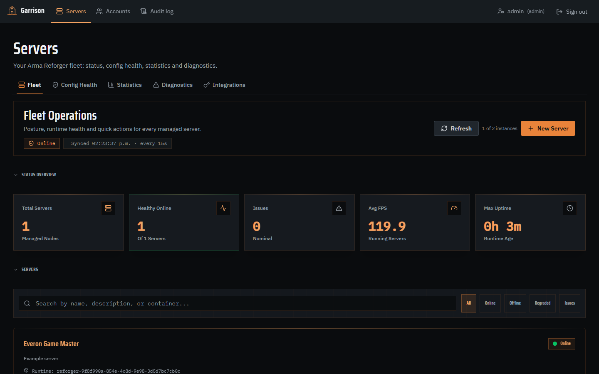
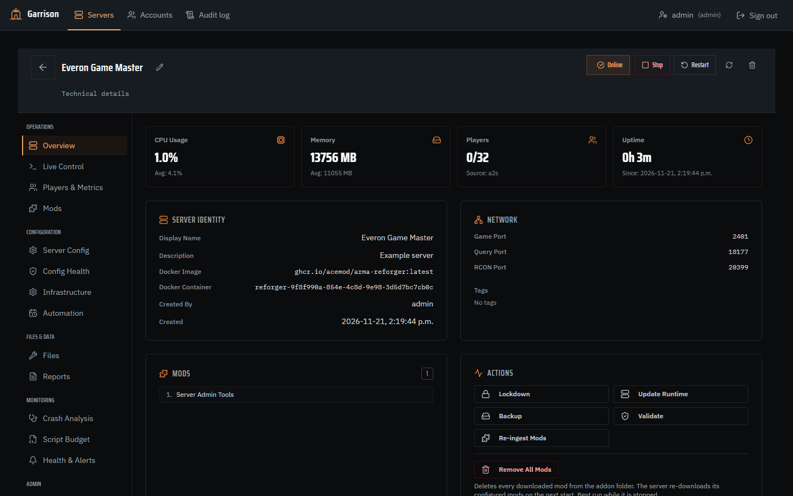

# Garrison

A self-hosted web panel for **Arma Reforger dedicated servers**. Run a fleet of
servers on your own Linux box from one browser tab: create and start servers,
manage mods from the Workshop, edit configs with live validation, watch the
console, run RCON, and get told when something breaks.

Each game server runs in its own Docker container (the community
[`acemod/arma-reforger`](https://github.com/acemod/docker-reforger) image). Garrison
creates the container, writes the config, publishes the ports and keeps an eye on it.





## Features

**Fleet**
- Fleet dashboard: status, players, FPS and uptime per server, start/stop/restart
- Create servers with automatic port allocation (game, query, RCON blocks)
- Config Health: one verdict per server from separate checks (container, panel
  state, Steam query, crash loop, incidents, config file drift, engine rules)
- Statistics and fleet-wide diagnostics (mod issues, log error catalogue)

**Per server**
- Overview with live CPU, memory, players and uptime
- Live console log stream and an RCON console (BattlEye) with quick commands
- Players list and history, metrics charts
- Mods: Workshop browser and search, load order editor, dependency resolution,
  presets, import/export JSON, mirror a loadout to or from other servers,
  revision history with diff and revert, compare against public servers
- Server config editor (form, raw JSON) with engine-rule lint while you type,
  config history with revert, and Server Admin Tools (SAT) settings and bans
- File manager: browse, edit, download (files or whole folders as ZIP), delete
- Automation: scheduled restarts, stops, starts and RCON commands
- Health and alerts: watchers, notifications, incidents
- Crash analysis that names the real cause of a failed boot and offers one-click fixes
- Script budget check and an optional call-target limit patch for very large mod sets
- Ops log for notes and handoffs between operators

**Panel**
- Local accounts with two roles: **admin** (servers, accounts, audit log) and **operator** (servers)
- Audit log of every change, with passwords and keys masked
- Server-down alerts to Discord (or any HTTPS webhook)
- Optional AI helpers (file assist, crash-fix suggestions, log triage) when you
  set an OpenAI or Anthropic API key. Everything works without them.

## Requirements

- A **Linux** host with Docker Engine and the Compose plugin
- About **20 GB of disk per server** (the game itself is ~12 GB) plus mods
- Enough CPU and RAM for your servers: plan on 2+ cores and 4-8 GB RAM each

Docker Desktop on Windows or macOS is not supported: Garrison uses host
networking so it can reach each server's RCON port on the host's loopback.

## Quick start

```bash
git clone https://github.com/25thplaymaking/garrison.git
cd garrison
cp .env.example .env
nano .env            # set JWT_SECRET, MONGO_PASSWORD and ADMIN_PASSWORD
sudo mkdir -p /srv/garrison/servers
docker compose up -d --build
```

Open `http://<your-host>:8000`, sign in with `ADMIN_USERNAME` / `ADMIN_PASSWORD`,
then change the password under **My account**.

Click **New Server**, give it a name and press **Start**. The first start
downloads the game (a few minutes). Open the server to see the live console.

Your players connect on the game port shown on the server's Overview (2001 for
the first server, 2011 for the second, and so on). Open those UDP ports, and the
query ports (17777, 17787, ...), in your firewall. Never open the RCON ports:
Garrison binds them to `127.0.0.1` on purpose.

## Put it behind HTTPS

The panel controls Docker on your host, so do not expose plain HTTP to the
internet. See [docs/reverse-proxy.md](docs/reverse-proxy.md) for Caddy and nginx
examples. Short version: bind the panel to `127.0.0.1` (`HOST=127.0.0.1`), let
the proxy terminate TLS, and set `TRUST_PROXY_HEADERS=true`.

## Configuration

All settings live in `.env`. The important ones:

| Setting | Default | What it does |
|---|---|---|
| `JWT_SECRET` | (required) | Signs session cookies. 32+ random characters. |
| `MONGO_PASSWORD` | (required) | Password for the bundled MongoDB. |
| `ADMIN_USERNAME` / `ADMIN_PASSWORD` | `admin` / (required) | First admin, created when no accounts exist. |
| `SERVER_DATA_ROOT` | `/srv/garrison/servers` | Where server files live. Same path inside and outside the container. |
| `PORT` / `HOST` | `8000` / `0.0.0.0` | Where the panel listens. |
| `COOKIE_SECURE` | `auto` | `auto` marks the cookie Secure on HTTPS requests. |
| `TRUST_PROXY_HEADERS` | `false` | Trust `X-Forwarded-For` from your reverse proxy. |
| `SERVER_DOCKER_IMAGE` | `ghcr.io/acemod/arma-reforger:latest` | Image used for game servers. |
| `MAX_SERVER_INSTANCES` | `8` | How many servers the panel may create. |
| `SERVER_PORT_BASE_GAME` / `_QUERY` / `_RCON` | `2001` / `17777` / `19999` | First port of each kind; each server takes the next block. |
| `SERVER_PORT_BLOCK_SIZE` | `10` | Gap between servers' ports. |
| `OPENAI_API_KEY` / `ANTHROPIC_API_KEY` | (empty) | Turns on the optional AI helpers. |
| `LOG_COLLECTOR_API_KEY` | (empty) | Lets an external log collector POST to `/api/log`. |

`backend/config.py` lists every setting with a comment.

## Security notes

- Anyone who can sign in as an operator can run commands in game containers and
  edit server files, and the panel holds the Docker socket. Treat operator
  accounts like server SSH access.
- Sessions are HttpOnly cookies; changing a password signs out every other session.
- Sign-in is rate limited per IP and per account.
- Webhook URLs must be HTTPS and resolve to a public address.
- RCON ports are published on `127.0.0.1` only.

## Updating

```bash
git pull
docker compose up -d --build
```

Game servers keep running while the panel restarts.

## Backups

Server files are in `SERVER_DATA_ROOT`. Panel data (servers, accounts, history)
is in the `mongo_data` Docker volume:

```bash
docker compose exec mongo mongodump -u garrison -p "$MONGO_PASSWORD" --authenticationDatabase admin --archive > garrison-db.archive
```

## Running without Docker (advanced)

The backend is a FastAPI app (Python 3.12) and the frontend a Vite/React app.
On a bare-metal install the panel runs as a normal user, so files a game
container creates as root may not be editable; see
[docs/permissions.md](docs/permissions.md) for the small sudo helper that fixes that.

## Development

```bash
# backend
cd backend
python -m venv .venv && . .venv/bin/activate
pip install -r requirements-dev.txt
pytest

# frontend (proxies /api to http://localhost:8000)
cd frontend
npm ci
npm run dev
npm test
npm run lint
```

## License

[MIT](LICENSE). Arma Reforger is a trademark of Bohemia Interactive. Garrison is
not affiliated with or endorsed by Bohemia Interactive.
